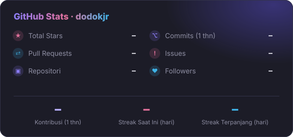
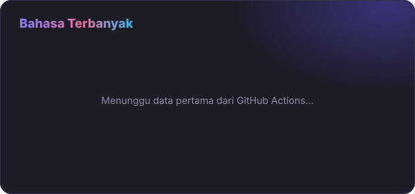

<div align="center">



<br/>

<a href="https://mfikria.vercel.app"></a>
<a href="https://www.linkedin.com/in/muhammad-fikri-ardiyansah/"></a>
<a href="https://instagram.com/fkri.ardn"></a>
<a href="mailto:ffikri604@gmail.com"></a>

<br/><br/>


<br/>


</div>

<br/>

## 🚀 Tentang Saya

<table width="100%">
  <tr>
    <td width="64%" valign="top">

👋 Halo! Saya **Muhammad Fikri Ardiyansah** (alias [dodokjr](https://mfikria.vercel.app)), full-stack software engineer yang berbasis di **Indonesia**.

💻 Fokus di ekosistem **JavaScript, TypeScript, dan Go** — membangun arsitektur web yang kokoh, sistem backend yang scalable, dan antarmuka modern.

🌱 Saat ini sedang mendalami *backend automation*, *modular framework*, dan *quantitative system patterns*.

☕ Di luar coding: ngopi, fotografi, dan gaming.

</td>
    <td width="36%" valign="middle">

```ts
const fikri = {
  role: "Full-Stack Engineer",
  langs: ["TypeScript", "Go"],
  focus: ["Backend", "Automation"],
  fuel: "☕ coffee",
  openToWork: true,
} as const;
```

</td>
  </tr>
</table>

<br/>

## ⚡ Tech Stack

<div align="center">

<table>
  <tr>
    <td align="center" width="170"><b>🧠 Languages</b></td>
    <td>
      
      
      
      
    </td>
  </tr>
  <tr>
    <td align="center"><b>🎨 Frontend &amp; Mobile</b></td>
    <td>
      
      
      
      
      
    </td>
  </tr>
  <tr>
    <td align="center"><b>⚙️ Backend &amp; Data</b></td>
    <td>
      
      
      
      
    </td>
  </tr>
  <tr>
    <td align="center"><b>🛠️ Tools</b></td>
    <td>
      
      
    </td>
  </tr>
</table>

</div>

<br/>

## 📂 Proyek Open-Source Pilihan

<table width="100%">
  <tr>
    <td width="50%" valign="top">

### 🛡️ [Flex-Auth](https://github.com/dodokjr/Flex-Auth)
<sub>Authentication Framework</sub>

Framework autentikasi modular berbasis TypeScript yang ringan, dengan dukungan **JWT**, **Refresh Token**, dan **OTP**.

  

</td>
    <td width="50%" valign="top">

### 🌐 [Mfikria Portfolio](https://github.com/dodokjr/mfikria)
<sub>Personal Website · [Live ↗](https://mfikria.vercel.app)</sub>

Portofolio pribadi yang interaktif dan dinamis untuk memamerkan karya serta dokumentasi API endpoint.

  

</td>
  </tr>
  <tr>
    <td width="50%" valign="top">

### 🤖 [AI Gateway](https://github.com/dodokjr/AI-Gateway)
<sub>AI Integration Hub</sub>

Layanan gateway backend untuk mengintegrasikan berbagai penyedia kecerdasan buatan secara efisien.

  

</td>
    <td width="50%" valign="top">

### 🛒 [App Kasir (GalaxyKasir)](https://github.com/dodokjr/App-Kasir)
<sub>POS Web Application</sub>

Aplikasi Point-of-Sale multi-cabang dengan pelacakan kehadiran kasir dan sistem izin multi-tier.

 

</td>
  </tr>
  <tr>
    <td width="50%" valign="top">

### 📱 [Apk Learning](https://github.com/dodokjr/Apk-learning)
<sub>Mobile Learning Platform</sub>

Aplikasi mobile interaktif untuk sinkronisasi data dan pembelajaran mandiri yang responsif.

 

</td>
    <td width="50%" valign="top">

### ⚡ [API Mfikria](https://github.com/dodokjr/api-mfikria)
<sub>Backend API Service</sub>

Kumpulan endpoint backend modular untuk mendukung berbagai layanan integrasi aplikasi web dan mobile.

  

</td>
  </tr>
</table>

<p align="center">
  <a href="https://github.com/dodokjr?tab=repositories">
    
  </a>
</p>

<br/>

## 📊 GitHub Stats

<div align="center">




<sub>🔄 Diperbarui otomatis tiap 12 jam lewat GitHub Actions</sub>

</div>

<br/>

## 🤝 Ayo Terhubung

> Punya ide proyek, butuh kolaborasi, atau sekadar ingin ngobrol soal TypeScript & kopi? Kirim pesan kapan saja.

<div align="center">

<a href="mailto:ffikri604@gmail.com"></a>
<a href="https://mfikria.vercel.app/me"></a>

<br/><br/>

<sub>🎨 Tema visual terinspirasi palet <a href="https://nusacss-app.vercel.app">Nusa CSS</a> · <a href="https://dodokjr.github.io/dodokjr/">Lihat versi web ↗</a></sub>


</div>
